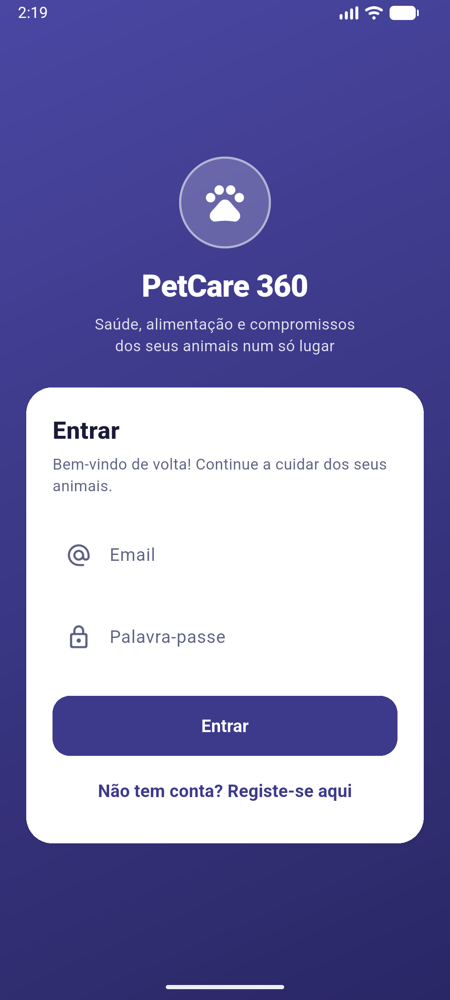
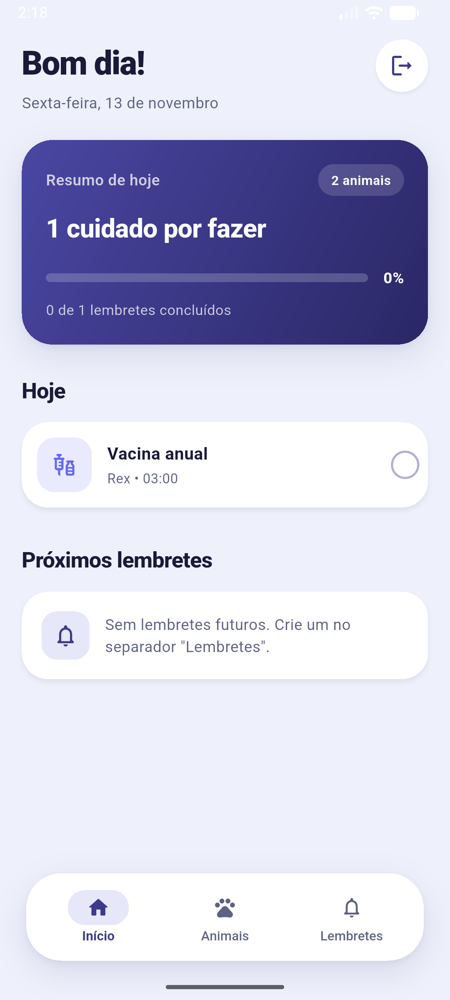
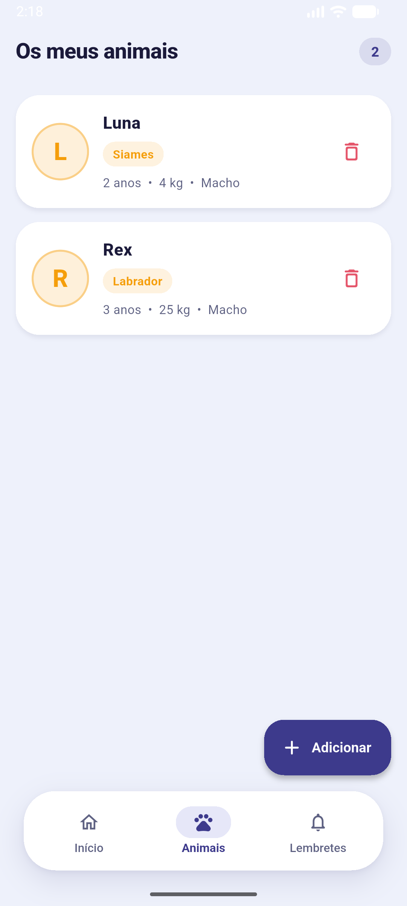
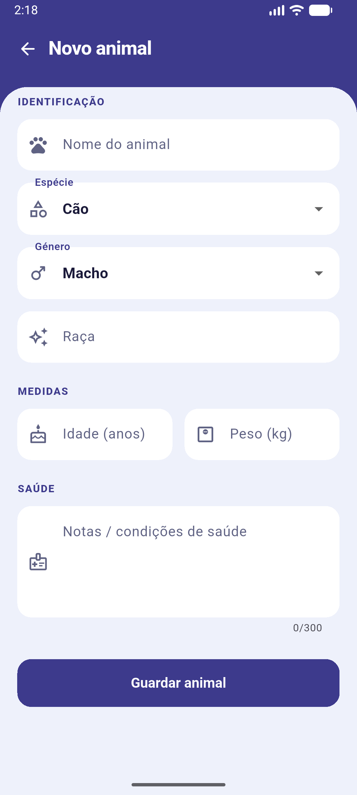
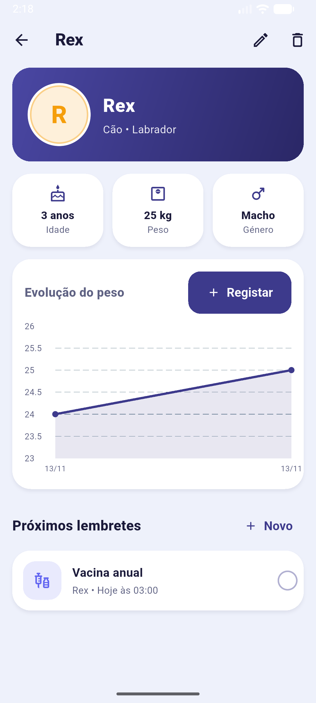
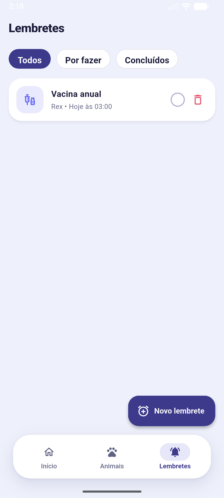
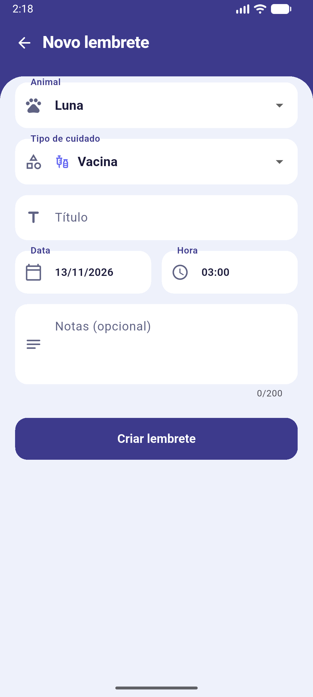

# PetCare 360 — Manual da Aplicação

**Unidade curricular:** Programação para Dispositivos Móveis
**Instituição:** ISPGAYA
**Curso:** TPSI
**Fase:** TP1 — versão inicial
**Data:** 13 de novembro de 2026

---

## 1. Descrição geral

A **PetCare 360** é uma aplicação para donos de animais de companhia que reúne, num único lugar, os dados dos animais, o seu peso ao longo do tempo e os cuidados que precisam de ser feitos: vacinas, banhos, desparasitações, medicação, alimentação e passeios.

**Problema que resolve:** a informação sobre a saúde e a rotina dos animais costuma andar dispersa (papel, notas, memória). A aplicação centraliza essa informação e avisa o utilizador quando há um cuidado agendado.

**Público-alvo:** donos de cães, gatos e outros animais de companhia que querem organizar a saúde e a rotina dos seus animais.

**Contexto de utilização:** uso pessoal no telemóvel, no dia a dia. A aplicação funciona sem internet, porque os dados ficam guardados no próprio dispositivo.

---

## 2. Primeiros passos

1. Abra a aplicação. Se ainda não tem conta, toque em **«Não tem conta? Registe-se aqui»**.
2. Introduza um **email** válido e uma **palavra-passe** com pelo menos 6 caracteres.
3. Toque em **Registar**. A conta fica criada e a sessão iniciada.
4. Nas próximas utilizações, basta introduzir o email e a palavra-passe e tocar em **Entrar**.

_Figura 1 — Ecrã de entrada. A partir daqui acede-se ao registo e ao login._

Para terminar a sessão, toque no ícone de saída (canto superior direito do ecrã Início).

---

## 3. Funcionalidades disponíveis

A aplicação tem três separadores, visíveis na barra inferior: **Início**, **Animais** e **Lembretes**.

### 3.1 Início (dashboard)

Mostra o resumo do dia:

- **Resumo de hoje:** cartão com o número de cuidados por fazer, a percentagem concluída e o número de animais registados.
- **Hoje:** lista dos lembretes do dia. Toque no círculo à direita para marcar um lembrete como concluído.
- **Próximos lembretes:** os três próximos lembretes ainda por fazer.

_Figura 2 — Início, com um lembrete de vacina para hoje e um animal registado._

### 3.2 Animais

Lista todos os animais registados, por ordem alfabética, com nome, raça, idade, peso e género.

- **Adicionar um animal:** toque no botão **Adicionar** (canto inferior direito) e preencha o formulário.
- **Ver o perfil:** toque no cartão de um animal.
- **Remover um animal:** toque no ícone da lixeira no cartão. A aplicação pede confirmação, e os lembretes e o histórico de peso do animal são removidos com ele.

_Figura 3 — Lista de animais. Quando não há animais, aparece um ecrã de boas-vindas com um botão para adicionar o primeiro._

#### Formulário de animal

_Figura 4 — Formulário para registar um animal. Os erros aparecem por baixo de cada campo, logo que o utilizador sai do campo._

#### Perfil do animal

No perfil vê-se a ficha do animal (idade, peso e género), o **gráfico da evolução do peso** e os próximos lembretes desse animal.

- **Registar peso:** toque em **Registar** no cartão de evolução do peso. Cada novo peso atualiza o gráfico. O gráfico só aparece depois de haver pelo menos dois registos de peso.
- **Editar:** toque no ícone do lápis, no cabeçalho.
- **Remover:** toque no ícone da lixeira, no cabeçalho.
- **Novo lembrete:** toque em **Novo**, na secção de próximos lembretes.

_Figura 5 — Perfil do animal com o gráfico da evolução do peso e o lembrete seguinte._

### 3.3 Lembretes

Lista todos os lembretes, dos mais próximos aos mais distantes. Os filtros no topo permitem ver:

- **Todos**
- **Por fazer**
- **Concluídos**

Cada lembrete mostra o tipo de cuidado (com ícone e cor próprios), o animal, a data e a hora. Toque no lembrete para o editar, no círculo para o marcar como concluído, ou no ícone da lixeira para o remover.

_Figura 6 — Lista de lembretes, com o filtro «Todos» selecionado._

#### Formulário de lembrete

Campos:

- **Animal:** escolhe-se de uma lista com os animais registados.
- **Tipo de cuidado:** Vacina, Banho, Desparasitação, Alimentação, Passeio, Medicação ou Outro.
- **Título:** obrigatório (por exemplo, «Vacina da raiva»).
- **Data e hora:** escolhidas nos seletores. Por omissão, a hora é a seguinte à atual.
- **Notas:** opcional, até 200 caracteres.

Ao guardar, a aplicação pede permissão para enviar notificações (apenas na primeira vez) e agenda um aviso para a hora do lembrete.

_Figura 7 — Formulário de novo lembrete._

---

## 4. Exemplo de utilização

1. Registe-se e entre na aplicação.
2. Em **Animais**, toque em **Adicionar** e registe o seu animal (por exemplo, nome «Rex», cão, labrador, 3 anos, 24 kg).
3. Abra o perfil do animal e toque em **Registar** para acrescentar um novo peso. O gráfico passa a mostrar a evolução.
4. Toque em **Novo**, no perfil, para criar um lembrete (por exemplo, «Vacina anual», para a data prevista).
5. No separador **Início**, veja o cuidado do dia e marque-o como concluído quando o fizer.

---

## 5. Erros conhecidos e limitações (TP1)

- **Autenticação simulada:** as contas e a sessão ficam guardadas apenas no dispositivo, sem servidor. A palavra-passe não é cifrada. A autenticação real (Firebase) fica para o TP2.
- **Dados só no dispositivo:** os animais e os lembretes não são sincronizados entre dispositivos. A persistência em cloud fica para o TP2.
- **Notificações:** a aplicação agenda uma notificação para a hora de cada lembrete.
- **Sem integração externa:** ainda não há chamadas a APIs externas (por exemplo, informação sobre raças). Fica para o TP2.
- **Plataformas:** a aplicação foi testada num emulador Android.
- **Idioma:** a interface está em português de Portugal.
